

# 🎯 PrismFilter · 双色球过滤计算工作台

### 全空间 1,107,568 注组合 · 多线程秒级过滤 · 核心功能离线运行 · 数据不出你的电脑

**官方发布仓库** —— 在这里下载程序、接收自动更新；本页面即产品说明。

---

## 📥 下载

**最新版**：前往 [发行版（Releases）页面](https://gitee.com/firswof/prism-filter-bin/releases)，下载最新发行版的程序附件（如 `PrismFilter.exe`）；历史版本在同一页面按版本归档。

**示例方案**：[samples/示例方案.wof](samples/示例方案.wof) —— 下载后在程序中「打开方案」载入，即可体验完整过滤流程。

> 下载后放到任意**可写目录**（建议不要放 `C:\Program Files`，更新替换需要写权限），双击运行即可——绿色单文件，无需安装。

## 🔄 自动更新

无需任何配置，程序出厂即内置官方更新源：

- 启动约 5 秒后自动检查一次更新；「帮助 → 检查更新…」可随时手动检查；
- 发现新版本：窗口内直接下载 → **SHA-256 完整性校验** → 一键重启自动替换；
- 失败安全：校验不过即中止，替换失败不会损坏现有程序。

## 📸 界面一览

| 页面 | 截图 |
| --- | --- |
| 特征约束 | 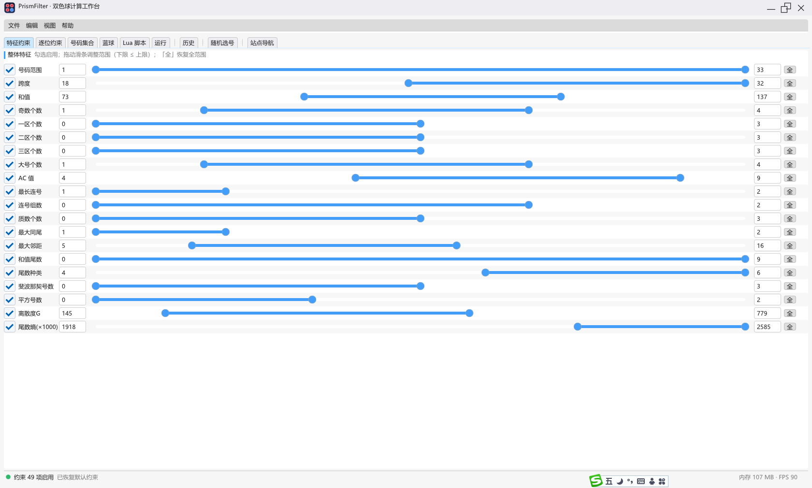 |
| 逐位约束 | 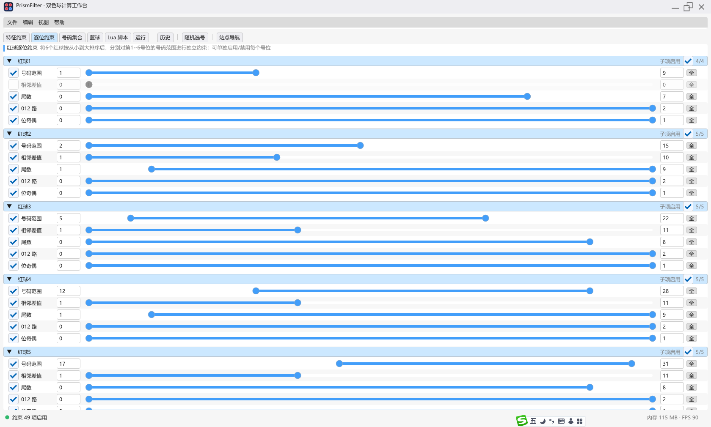 |
| 号码集合 | 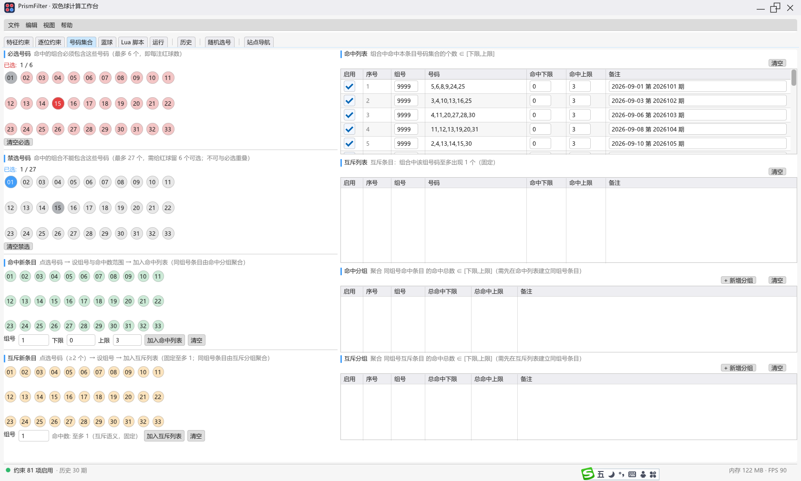 |
| 蓝球 | 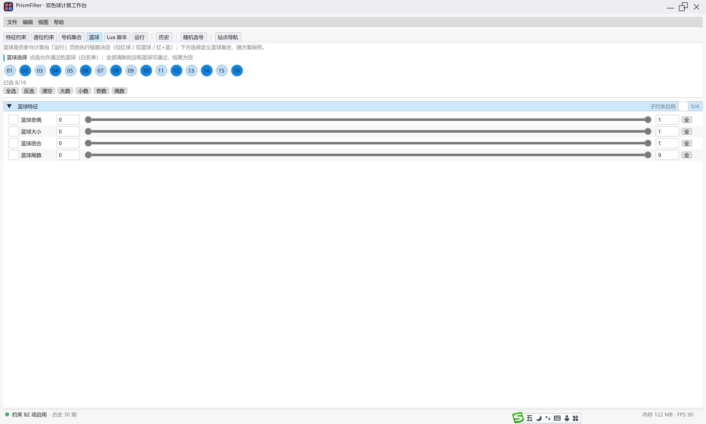 |
| Lua 脚本 | 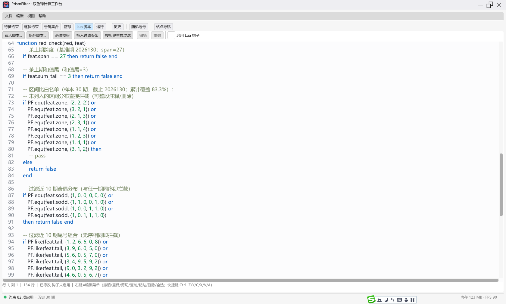 |
| 运行（含结果列表） | 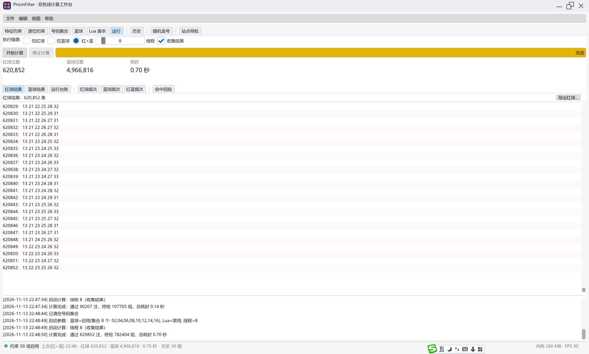 |
| 频次统计 | 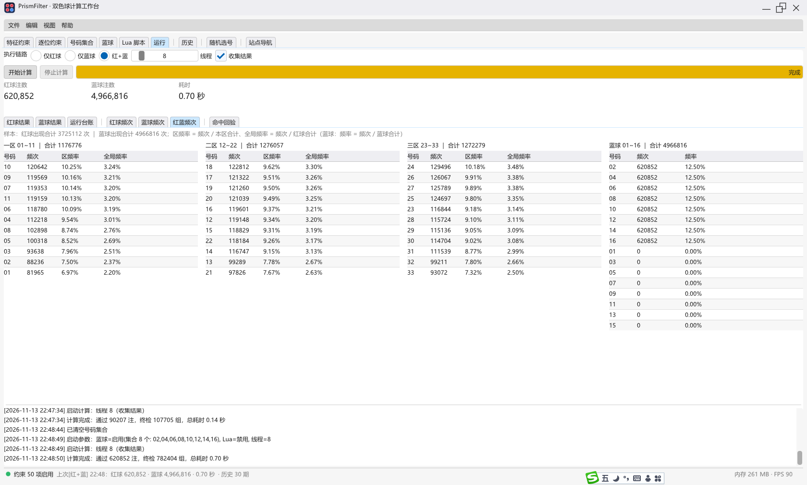 |
| 命中回验 | 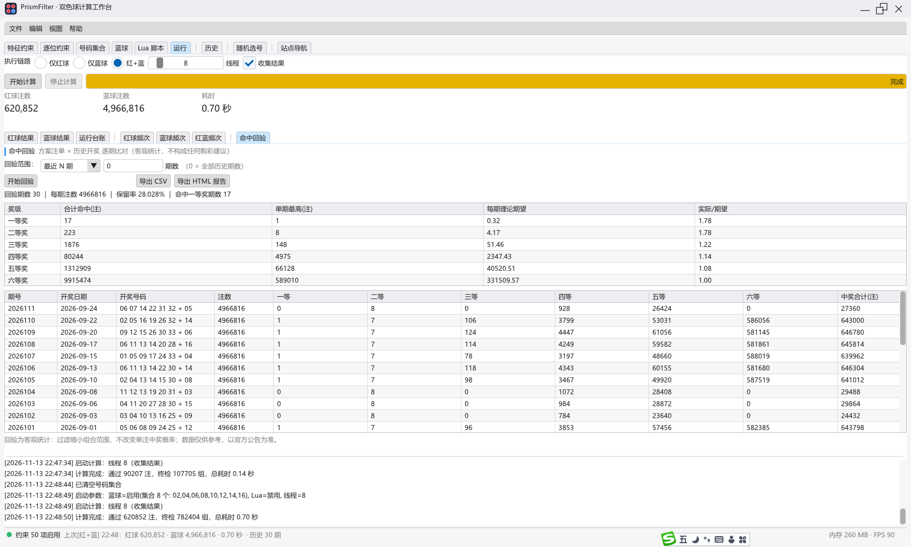 |
| 历史数据 | 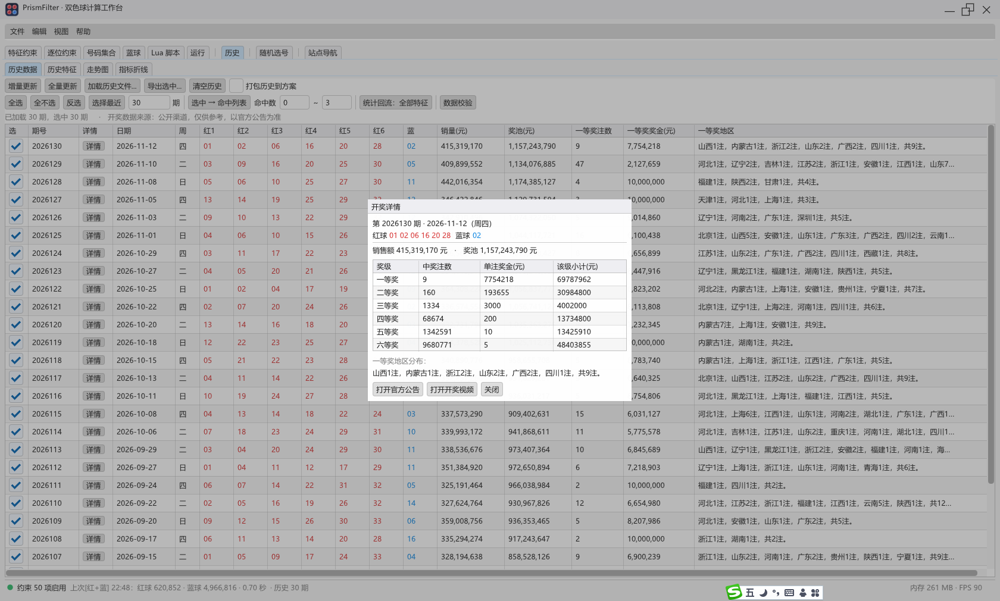 |
| 历史特征 | 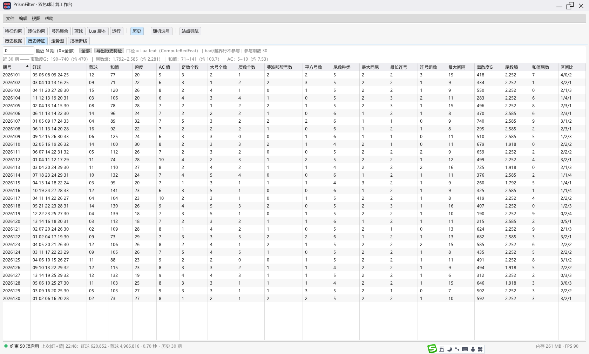 |
| 走势图 | 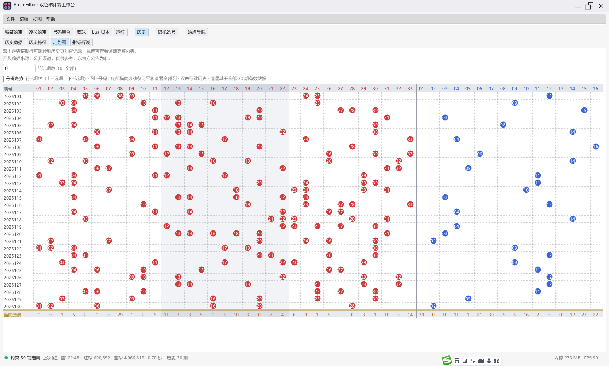 |
| 指标折线 | 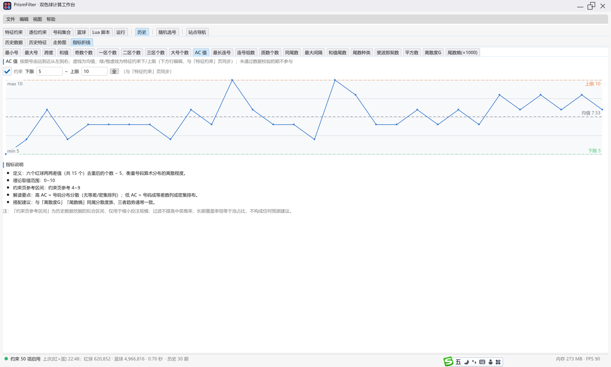 |
| 随机选号 | 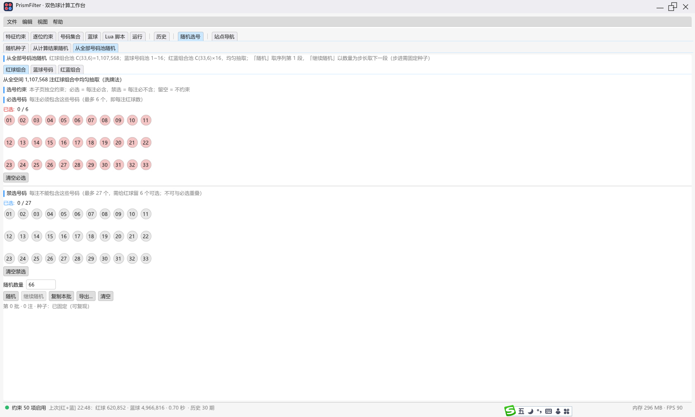 |
| 站点导航 | 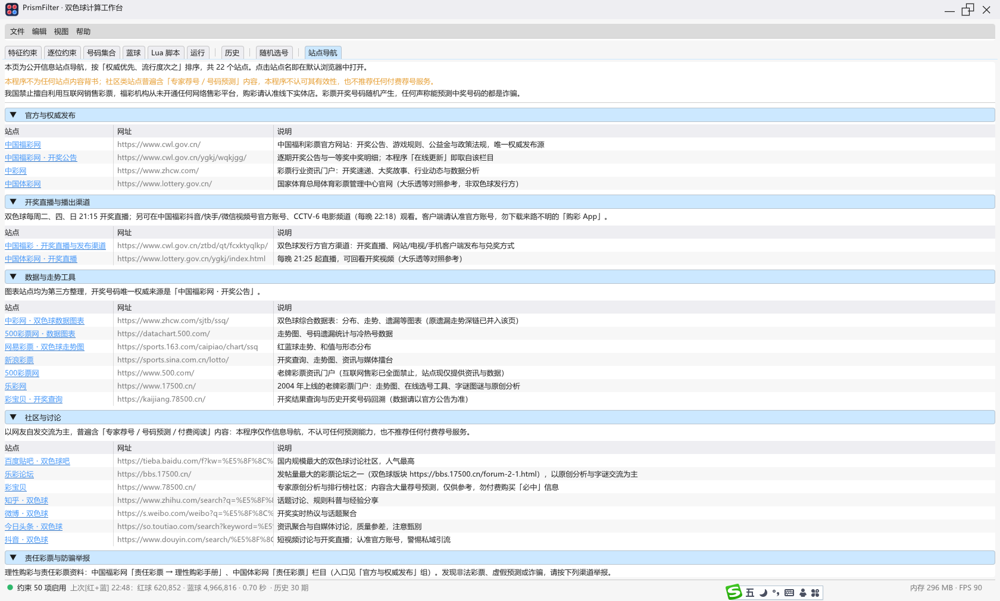 |
| 授权与购买 | 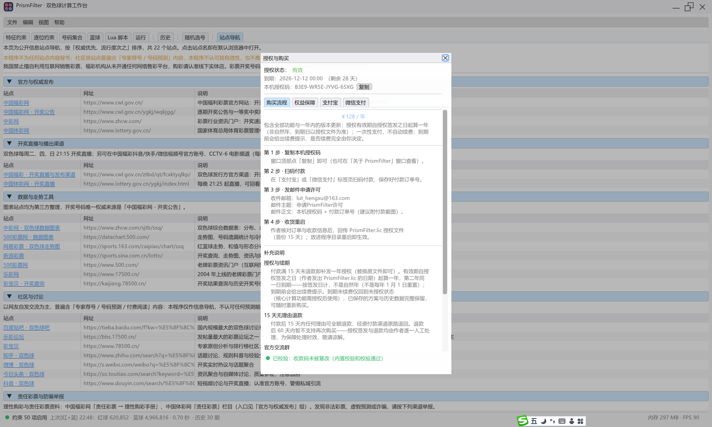 |

---

## ✨ 它强在哪里

### 🚀 全空间 · 秒级
C(33,6) = **1,107,568** 注全空间组合，多线程并行扫描，通常数秒完成（视机器性能）。
边算边出结果，界面全程不卡顿；「停止计算」一键中止，随时可控。

### 🎛️ 20+ 维特征约束，指哪打哪
和值、跨度、奇偶比、AC 值、连号、三分区、最大同尾、尾数熵（信息论口径）……
**20 项整体特征 + 6 位逐位独立约束**（位号码范围 / 相邻差值 / 尾数 / 012 路 / 位奇偶），
双端滑条所见即所得，任意组合叠加过滤，实时校验合法性。

### 📜 Lua 脚本：把你的想法写成规则
`red_check(red, feat)` 一个函数，接入 28 个实时计算字段。
语法高亮编辑器 + 纯编译校验（中文报错定位）+ 一键插入过滤骨架。

### 📈 历史数据全家桶
开奖数据一键在线更新；走势图 / 遗漏 / 21 项指标折线；历史特征逐期表格；
**统计回流**——勾选历史期次，自动反推特征约束范围。

### 🎲 常规随机选号（免费）
数字 / 日期 / 文本 / 图像四种种子源，同种子整条序列可复现；
红球组合全空间均匀抽取、蓝球号码、红蓝组合双轴独立重掷，每批最多 10,000 注。

### ✅ 命中回验：用历史检验策略
你的注单 × 历史开奖逐期比对：各奖级命中注数、单期最高、随机理论期望与倍率，
支持导出 CSV 明细与 HTML 分享报告。

### 🔒 隐私与安全，写在架构里
- **核心功能全部本机离线完成**：不收集、不上传任何用户数据，仅更新检查与开奖数据获取访问网络；
- **授权码 = 硬件标识单向哈希**，不含姓名账号等个人信息；
- **方案文件加密容器**（zlib + AES-256-CBC + SHA-256），防查看、防篡改；
- **程序完整性自校验**：程序关键数据与节区哈希锚定，检测到篡改即拒绝运行。

---

## 💰 免费 vs 授权

**免费开放，无任何使用限制：**
方案与历史数据的浏览、编辑与保存——特征约束、逐位约束、号码集合、蓝球选择等
全部配置编辑，历史数据的加载、在线更新与校验，走势图、历史特征查询，
常规随机选号，以及站点导航。
**您的数据始终由您自己掌控，保存与载入不受任何限制。**

**需要授权（双色球方案的执行计算）：**
开始计算（全空间组合枚举与过滤，含命令行）、Lua 脚本钩子、约束预设一键套用。
依赖计算结果的展示（结果列表、导出、从计算结果随机等）随计算一同开放。

### 授权与价格

| 项目 | 说明 |
| --- | --- |
| 价格 | **￥128 / 年**（非订阅制，**无自动续费**） |
| 授权范围 | 有效期内上述执行能力全部开放，并含版本更新 |
| 到期后 | 仅执行计算回到未授权状态；已保存的方案与历史数据完整保留，软件本体功能继续免费开放 |
| 获取方式 | 程序内「帮助 → 授权与购买」：复制本机授权码 → 扫码付款（备注填授权码，或直接发给作者）→ 作者人工签发授权文件 |

完整条款见 [license/EULA.md](license/EULA.md)。

---

## 🛡️ 合规声明（请务必阅读）

- 本软件是开奖数据的**统计、过滤与分析工具**，仅供个人研究学习与数据娱乐使用；
- 不提供、不参与任何形式的彩票销售、代购或投注服务，不涉及任何资金往来；
- 所有功能均为对历史数据与组合空间的**客观计算**：**任何过滤规则都不改变单注中奖概率，
  也无法预测开奖结果**，不构成任何购彩建议；
- 开奖数据来自公开渠道，以官方公告为准；请理性购彩、量力而行，未成年人不得购买彩票或兑奖。

---

**理性购彩 · 量力而行 · 数据娱乐 · 拒绝预测迷信**

